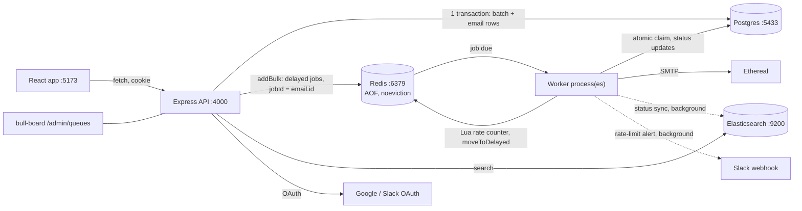

# ONB Outbox: email job scheduler and dashboard

A full-stack email scheduler built for the ReachInbox (Outbox Labs) assignment.
A logged-in user writes one email, uploads a list of recipients and picks a
start time, the gap between emails and an hourly limit. The backend stores
every email and schedules it as a **BullMQ delayed job**; there is no cron.
Worker processes send through Ethereal SMTP while respecting per-sender
hourly limits. Every email is sent **at most once**, even across restarts,
crashes and retries.

- **Backend:** TypeScript, Express 5, BullMQ + Redis, Prisma + Postgres,
  Nodemailer (Ethereal), Elasticsearch, Slack OAuth, Google OAuth,
  email/password login (bcrypt).
- **Frontend:** React 19, Vite, TypeScript, Tailwind CSS v4, React Router,
  TanStack Query, TipTap editor.
- **Designs:** the Figma screenshots the UI was built from are in [`design/`](design/).
- **Demo video:** _link coming soon_
- **Load test results:** [`docs/load-test.md`](docs/load-test.md)

---

## Contents

1. [Features](#features)
2. [Running it locally](#running-it-locally)
3. [Deploying (Vercel + Railway)](#deploying-vercel--railway)
4. [Configuration (env variables)](#configuration-env-variables)
5. [Architecture](#architecture)
6. [Behavior under load](#behavior-under-load)
7. [Assumptions, shortcuts and trade-offs](#assumptions-shortcuts-and-trade-offs)
8. [Project layout](#project-layout)

---

## Features

### Backend

| Area | What it does |
|---|---|
| **Scheduler** | `POST /api/emails/schedule` stores one batch plus one row per recipient in a single transaction, then adds one BullMQ **delayed job per email** (`jobId = email.id`). Email *i* is due at `startTime + i × delayBetweenMs`. Recipients are spread round-robin over the senders. No cron. |
| **Persistence** | Postgres is the source of truth. Redis runs with AOF (`appendonly yes`) and `noeviction`, so delayed jobs survive a Redis restart. On boot, both the API and the worker **reconcile**: any `scheduled` row without a job gets one again. |
| **Rate limiting** | Per sender, per clock hour, using an atomic Redis Lua counter shared by all workers. When a sender is full, the job is moved (`moveToDelayed`) to a later hour without failing it, and overflow is spread over the following hours in the original order. |
| **Concurrency** | `WORKER_CONCURRENCY` jobs at once per worker process, plus a queue-wide BullMQ limiter: at most 1 job starts per `MIN_DELAY_MS` across all workers. |
| **Idempotency** | Each send starts with an atomic claim (`UPDATE … SET status='sending' WHERE status='scheduled'`). Duplicate jobs, retries and re-queues can't send twice. Every email gets a deterministic `Message-ID`. |
| **Retries** | Transient SMTP failures retry up to `JOB_ATTEMPTS` times with exponential backoff, then the email becomes `failed` with the error stored. |
| **Slack alerts** | Users connect Slack (OAuth, incoming webhook). When a sender hits the hourly limit for their emails, they get one message per sender per hour. It never blocks sending. |
| **Search** | Elasticsearch full-text search over recipient, subject and body. Writes are versioned, so an older status can't overwrite a newer one. `npm run reindex` rebuilds the index from Postgres. If ES is down, sending still works. Without `ELASTICSEARCH_URL`, search falls back to Postgres `ILIKE`. |
| **bull-board** | Queue dashboard at `/admin/queues`, for logged-in users listed in `ADMIN_EMAILS` only. |
| **Authentication** | **Google OAuth** (a signed `state` checked against a cookie, against CSRF) or **email + password** (`POST /auth/signup`, `POST /auth/login`; bcrypt, cost from `BCRYPT_COST`, minimum 12). Both set the same httpOnly session cookie (signed JWT). Wrong email and wrong password get the same "Invalid email or password" answer with the same timing. Login and signup are rate-limited in Redis per IP and per email. Every `/api/*` route requires login, and every query is scoped to the logged-in user. |
| **HTML bodies** | The editor's HTML is sanitized on the server (allowlist) and sent as HTML plus a plain-text fallback. Body size is capped by `MAX_BODY_BYTES`. |

### Frontend

| Screen / feature | What it does |
|---|---|
| **Login / Sign up** | One card with two modes: **Login** (email + password) and **Sign up** (name, email, password), plus "Login with Google". Field errors appear under the field; other errors (wrong password, email taken, Google account, too many attempts) above the form. Clear messages for OAuth errors (`?error=…`). |
| **Dashboard** | Sidebar with the ONB logo, a user card (Slack connect/disconnect, Log out), Compose, and **Scheduled** / **Sent** tabs with live counts. |
| **Tables** | Scheduled (scheduled + sending) and Sent (sent + failed) lists: recipient, time or status pill (failed ones show the error on hover), subject + preview, Ethereal preview link, Gmail-style pagination. |
| **Search** | Debounced (300 ms) full-text search within the open tab. |
| **Compose** | Recipient chips (type, paste or **upload a CSV/TXT**; header rows, quotes, extra columns, duplicates and invalid addresses are handled and reported), subject, delay in seconds, hourly limit, rich-text editor (TipTap), **Send** now or **Send Later** (date-time picker with presets). Server errors are shown next to the right field. |
| **Detail page** | Sender, recipient, date, status, failure reason, and the body (sanitized again with DOMPurify before display). |
| **Slack connect** | Connect or disconnect from the user menu. A toast confirms the result after the OAuth round trip. |
| **States** | Skeleton loaders, empty states (per tab and for searches), error states with Retry, toasts. |
| **Polling** | Lists and counts refresh on their own when a send is near (details under [Polling](#polling-frontend)). |
| **Session handling** | A 401 anywhere means "logged out": one redirect to `/login`, no retry loop. |

---

## Running it locally

### Prerequisites

- **Node.js 20.19+ or 22.12+** (what Vite 8 requires) and npm. Tested on Node 22.14.
- **Docker** with Docker Compose.
- Internet access (Ethereal, Google, and Slack if you use it).
- About 2 GB of free RAM for the containers. Elasticsearch alone takes about 1 GB.
- Optional: **ngrok** (or any HTTPS tunnel) for Slack OAuth.

### 1. Start Postgres, Redis and Elasticsearch

```bash
docker compose up -d
docker compose ps        # wait until all three are "healthy" (ES takes ~30-60 s)
```

> **Postgres is on host port 5433, not 5432.** A Postgres installed directly
> on the machine often owns 5432 and would silently answer instead of the
> container. Redis is on 6379, Elasticsearch on 9200.

### 2. Configure the backend

```bash
cd backend
cp .env.example .env
npm install                 # also generates the Prisma client (postinstall)
```

Fill in at least these values in `backend/.env`. Everything else already has
working values:

| Key | How to get it |
|---|---|
| `JWT_SECRET` | `node -e "console.log(require('crypto').randomBytes(48).toString('base64url'))"` |
| `GOOGLE_CLIENT_ID`, `GOOGLE_CLIENT_SECRET` | See [Google OAuth](#google-oauth-required) below |
| `ADMIN_EMAILS` | Your Google email, if you want to open bull-board |
| `SLACK_*`, `PUBLIC_BASE_URL` | Optional. See [Slack app](#slack-app-optional) below |

### 3. Create the tables and the senders

```bash
npx prisma migrate deploy   # creates the tables
npm run db:seed             # creates SEED_SENDER_COUNT (default 3) Ethereal sender accounts
                            # (the API also does this on startup if there are none)
```

**Ethereal** is a fake SMTP service. Messages sent through it are captured,
never delivered. The seed script creates one Ethereal account per sender
through Nodemailer's API, so no signup is needed. It prints each account's
login. Every sent email also gets a **Preview** link in the UI that opens the
captured message. The seed is safe to re-run; it only creates missing senders.

### 4. Start the API and the worker

```bash
npm run dev:all      # API on http://localhost:4000 + one worker process
```

Or start them in two terminals with `npm run dev` and `npm run dev:worker`.
You can start more workers; correctness doesn't depend on there being only one.

### 5. Start the frontend

```bash
cd ../frontend
cp .env.example .env        # VITE_API_URL=http://localhost:4000
npm install
npm run dev                 # http://localhost:5173
```

Open <http://localhost:5173> and log in with Google, or click **Sign up** to
create an email/password account.

### Google OAuth (required)

1. In [Google Cloud Console](https://console.cloud.google.com/), create or
   choose a project.
2. Go to **APIs & Services → OAuth consent screen**. Choose *External*, fill in
   the app name and your email, and keep the default scopes (the app asks only
   for `openid email profile`).
3. While the app is in **Testing** mode, add every Google account that will log
   in under **Test users**.
4. Go to **APIs & Services → Credentials → Create credentials → OAuth client
   ID**, with type *Web application*.
   - **Authorized redirect URIs:** `http://localhost:4000/auth/google/callback`.
     This must equal `GOOGLE_CALLBACK_URL` exactly.
   - No JavaScript origins are needed, because the code exchange happens on
     the server.
5. Copy the client ID and secret into `GOOGLE_CLIENT_ID` / `GOOGLE_CLIENT_SECRET`.

### Slack app (optional)

Slack only redirects to **HTTPS**, so the API needs a public HTTPS URL during
local development:

1. Run `ngrok http 4000` and copy the `https://….ngrok-free.app` URL into
   `PUBLIC_BASE_URL` (no trailing slash). The free plan gives you a new URL on
   each start, so update `.env` and the Slack redirect URL when it changes.
2. Create a Slack app at <https://api.slack.com/apps>, either **From scratch**
   or from this manifest (replace the domain):

   ```yaml
   display_information:
     name: Outbox Scheduler Alerts
   oauth_config:
     redirect_urls:
       - https://YOUR-NGROK-DOMAIN/auth/slack/callback
     scopes:
       bot:
         - incoming-webhook
   settings:
     org_deploy_enabled: false
     socket_mode_enabled: false
     token_rotation_enabled: false
   ```

   If you create it from scratch: under **OAuth & Permissions**, add the
   redirect URL `PUBLIC_BASE_URL/auth/slack/callback` and the scope
   `incoming-webhook`.
3. Under **Basic Information**, copy the client ID and secret into
   `SLACK_CLIENT_ID` / `SLACK_CLIENT_SECRET`, then restart the API.
4. In the app, open the user card → **Connect Slack** and pick a channel. If
   ngrok shows its "You are about to visit" page, click **Visit Site**.

Without Slack credentials the app runs normally: `/auth/slack` answers 503 and
alerts are skipped.

### bull-board

Put your Google email in `ADMIN_EMAILS` (comma-separated for several), restart
the API, log in through the frontend, then open
<http://localhost:4000/admin/queues>. Logged-in users who aren't listed get 403.

### Other commands

| Command (in `backend/`) | What it does |
|---|---|
| `npm run loadtest -- --leads 1200 --hourly-limit 5` | Load test; see [`docs/load-test.md`](docs/load-test.md). Run the API and worker with `SMTP_DRY_RUN=true` first. |
| `npm run reindex` | Rebuilds the Elasticsearch index from Postgres. |
| `npm run typecheck` / `npm run build` | Type-check / compile to `dist/`. |
| `npm start` / `npm run start:worker` | Run the compiled API / worker. |
| `npm run start:prod` | `prisma migrate deploy`, then the compiled API (what the Docker image runs). |

---

## Deploying (Vercel + Railway)

The hosted demo is split in two, and the browser only ever talks to Vercel:

```
browser ──► https://<app>.vercel.app
              ├─ everything else ─► the built SPA (vercel.json: SPA fallback to index.html)
              └─ /api/*  /auth/*  /admin/*  /health
                   └─ frontend/middleware.ts proxies to BACKEND_URL
                        └─► Railway service (backend/, Dockerfile)
                              prisma migrate deploy, then API + worker in one process
                              ├─ Railway Postgres
                              └─ Railway Redis        (no Elasticsearch)
```

Because the API is reached through the Vercel domain, the session cookie is
first-party (`SameSite=Lax`, `Secure`) and there are no CORS requests at all.
The OAuth callbacks go through Vercel too. `vercel.json` rewrites can't read
environment variables, so the proxy is a small
[Routing Middleware](frontend/middleware.ts) that reads `BACKEND_URL` at runtime.

### 1. Railway (backend, Postgres, Redis)

1. **New project → Deploy from GitHub repo**, pick this repo. In the service's
   **Settings**:
   - **Root Directory:** `/backend`
   - **Config-as-code file:** `/backend/railway.json` (Railway doesn't look
     inside the root directory for it, so the full path is needed). It builds
     [`backend/Dockerfile`](backend/Dockerfile) and health-checks `/health`.
2. **+ New → Database → PostgreSQL**, and again for **Redis**.
3. **Networking → Generate Domain.** This `https://….up.railway.app` URL is
   the `BACKEND_URL` for Vercel.
4. Set the variables below (**Variables → Raw Editor** accepts the contents of
   `backend/.env.example`; paste it, then change the values marked here).

On every start the container runs `prisma migrate deploy`, then the compiled
server. On first boot it creates the Ethereal senders itself, because the
table is empty (`npm run db:seed` isn't needed).

| Railway variable | Value |
|---|---|
| `NODE_ENV` | `production` (makes cookies `Secure`) |
| `PORT` | Don't set it. Railway provides it and the API reads it. |
| `FRONTEND_URL` | `https://<app>.vercel.app` (no trailing slash) |
| `DATABASE_URL` | `${{Postgres.DATABASE_URL}}` |
| `REDIS_URL` | `${{Redis.REDIS_URL}}` |
| `RUN_WORKER_IN_API` | `true`: the API process also runs the BullMQ worker |
| `ELASTICSEARCH_URL` | Leave it **unset/empty**: search uses Postgres instead |
| `ELASTICSEARCH_INDEX`, `ES_REQUEST_TIMEOUT_MS`, `ES_BULK_BATCH_SIZE` | Still validated at startup; keep the `.env.example` values |
| `JWT_SECRET` | A **new** random value, not the local one |
| `GOOGLE_CLIENT_ID`, `GOOGLE_CLIENT_SECRET` | Same OAuth client as locally, or a separate one |
| `GOOGLE_CALLBACK_URL` | `https://<app>.vercel.app/auth/google/callback` |
| `ADMIN_EMAILS` | Who may open `https://<app>.vercel.app/admin/queues` |
| `SLACK_CLIENT_ID`, `SLACK_CLIENT_SECRET` | Optional, as locally |
| `PUBLIC_BASE_URL` | `https://<app>.vercel.app` (already https, so no ngrok) |
| `SMTP_DRY_RUN` | `false` |
| `SEED_SENDER_COUNT` | `3` (senders created on first boot) |
| `JSON_BODY_LIMIT`, `WORKER_CONCURRENCY`, `MIN_DELAY_MS`, `MAX_EMAILS_PER_HOUR_PER_SENDER`, `JOB_ATTEMPTS`, `JOB_BACKOFF_MS`, `JOB_RETENTION_HOURS`, `STUCK_SENDING_THRESHOLD_MS`, `MAX_LEADS_PER_REQUEST`, `MAX_BODY_BYTES`, `RESCHEDULE_SEQ_OFFSET_MS`, `RECONCILE_BATCH_SIZE`, `SHUTDOWN_TIMEOUT_MS`, `PAGE_SIZE_DEFAULT`, `PAGE_SIZE_MAX`, `SESSION_TTL_MS`, `BCRYPT_COST`, `AUTH_RATE_WINDOW_MS`, `AUTH_MAX_ATTEMPTS_PER_IP`, `AUTH_MAX_ATTEMPTS_PER_EMAIL`, `GOOGLE_STATE_TTL_MS`, `GOOGLE_HTTP_TIMEOUT_MS`, `SLACK_STATE_TTL_MS`, `SLACK_HTTP_TIMEOUT_MS` | Required, with no defaults in code: the `.env.example` values work |
| `RAILWAY_DEPLOYMENT_DRAINING_SECONDS` | Optional, e.g. `30`: how long Railway waits after SIGTERM before killing the old deployment, so in-flight sends can finish (matches `SHUTDOWN_TIMEOUT_MS`) |

**Redis eviction policy.** Delayed jobs are ordinary Redis keys, so Redis must
not evict them. The API logs a warning at startup if `maxmemory-policy` isn't
`noeviction`. If you see it, run `CONFIG SET maxmemory-policy noeviction`
against the Railway Redis (from its **Data** tab or `redis-cli -u $REDIS_URL`).

### 2. Vercel (frontend)

1. **Add New → Project**, import the repo, **Root Directory:** `frontend`.
   [`frontend/vercel.json`](frontend/vercel.json) sets the Vite build and the
   SPA fallback.
2. Environment variables:

   | Vercel variable | Value |
   |---|---|
   | `BACKEND_URL` | The Railway domain, e.g. `https://outbox-api.up.railway.app` (no trailing slash). Read by the middleware at runtime; redeploy after changing it. |
   | `VITE_API_URL` | Leave it **unset/empty**: API calls go to the same origin and the middleware proxies them. |

3. Deploy, then put the production URL (`https://<app>.vercel.app`) into
   Railway's `FRONTEND_URL`, `GOOGLE_CALLBACK_URL` and `PUBLIC_BASE_URL`. Use
   the stable production domain, not a preview URL: preview URLs change on
   every deploy, and OAuth only accepts registered callback URLs.

### 3. Redirect URLs to update

| Where | Add |
|---|---|
| Google Cloud Console → APIs & Services → Credentials → your OAuth client → **Authorized redirect URIs** | `https://<app>.vercel.app/auth/google/callback` (must equal `GOOGLE_CALLBACK_URL`). While the consent screen is in *Testing*, every account that logs in must be a **Test user**. |
| Slack app → **OAuth & Permissions → Redirect URLs** (or `redirect_urls` in the manifest) | `https://<app>.vercel.app/auth/slack/callback` (= `PUBLIC_BASE_URL` + `/auth/slack/callback`) |

### 4. Check it

- `https://<app>.vercel.app/health` answers `{"ok":true}`, which shows the proxy works.
- The Railway logs show `RUN_WORKER_IN_API=true: starting the email worker`,
  `Worker … ready`, `[search] ELASTICSEARCH_URL not set: …`, and on first boot
  `[seed] created Sender 1 …`.
- Log in, schedule an email to yourself, and open its Ethereal **Preview** link.

**Hosted trade-offs.** Search without Elasticsearch is a case-insensitive
`ILIKE` on recipient, subject and body. Every word must match, there is no
relevance ranking and no index (it scans the user's rows), and the body is
matched as stored HTML. The per-IP login limit sees the address of the proxy
in front of Railway (Vercel's), so users arriving through the same Vercel
edge share that counter; the per-email limit is unaffected. During a redeploy
Railway briefly runs the old and new deployment side by side, so for a moment
there are two workers. That's safe (see [Idempotency](#idempotency-never-send-twice)).

---

## Configuration (env variables)

Every variable is listed with a placeholder and a comment in
[`backend/.env.example`](backend/.env.example) and
[`frontend/.env.example`](frontend/.env.example). The backend validates all
of them at startup (zod) and exits with a clear message if one is missing or
malformed. **Every limit is read from the environment; none is hardcoded.**

| Variable | Default in `.env.example` | Meaning |
|---|---|---|
| `NODE_ENV` | `development` | `production` makes cookies `Secure` |
| `PORT` | `4000` | API port |
| `FRONTEND_URL` | `http://localhost:5173` | Allowed CORS origin; where OAuth redirects back to |
| `JSON_BODY_LIMIT` | `2mb` | Max request body (bounds the leads array) |
| `DATABASE_URL` | `…@localhost:5433/outbox` | Postgres (note the port) |
| `REDIS_URL` | `redis://localhost:6379` | Redis for BullMQ, rate counters and Slack dedupe |
| `ELASTICSEARCH_URL`, `ELASTICSEARCH_INDEX` | `http://localhost:9200`, `emails` | Search. Empty URL = no indexing; search uses Postgres `ILIKE` |
| `ES_REQUEST_TIMEOUT_MS` | `3000` | Short timeout, so a slow ES never holds anything up |
| `ES_BULK_BATCH_SIZE` | `1000` | Documents per bulk request (reindex) |
| `WORKER_CONCURRENCY` | `5` | Parallel jobs per worker process |
| `MIN_DELAY_MS` | `1000` | Minimum gap between any two job starts, queue-wide (0 disables it) |
| `MAX_EMAILS_PER_HOUR_PER_SENDER` | `50` | Hard cap per sender per hour; a request's `hourlyLimit` can only lower it |
| `JOB_ATTEMPTS`, `JOB_BACKOFF_MS` | `3`, `5000` | SMTP retries with exponential backoff (5 s, 10 s, …) |
| `JOB_RETENTION_HOURS` | `168` | How long finished jobs stay in Redis / bull-board |
| `STUCK_SENDING_THRESHOLD_MS` | `900000` | A row in `sending` for longer than this (15 min) is marked `failed` on boot |
| `MAX_LEADS_PER_REQUEST` | `5000` | Max recipients per schedule request |
| `MAX_BODY_BYTES` | `102400` | Max email body size (100 KB) |
| `RESCHEDULE_SEQ_OFFSET_MS` | `10` | Spacing that keeps order when jobs move to a later hour |
| `RECONCILE_BATCH_SIZE` | `500` | Rows checked per round trip by reconcile |
| `SHUTDOWN_TIMEOUT_MS` | `30000` | How long the worker waits for in-flight sends on shutdown |
| `SMTP_DRY_RUN` | `false` | `true` skips the real SMTP call (load tests only) |
| `RUN_WORKER_IN_API` | `false` | `true` runs the BullMQ worker inside the API process (one hosted service) |
| `PAGE_SIZE_DEFAULT`, `PAGE_SIZE_MAX` | `20`, `100` | List pagination |
| `SEED_SENDER_COUNT` | `3` | Senders created by `npm run db:seed`, and by the API on startup when there are none |
| `JWT_SECRET` | placeholder | Signs session cookies and OAuth states (32+ chars) |
| `SESSION_TTL_MS` | `604800000` | Login lifetime (7 days) |
| `GOOGLE_CLIENT_ID`, `GOOGLE_CLIENT_SECRET` | empty | Google OAuth client (required) |
| `GOOGLE_CALLBACK_URL` | `http://localhost:4000/auth/google/callback` | Must match the redirect URI in Google Cloud |
| `GOOGLE_STATE_TTL_MS`, `GOOGLE_HTTP_TIMEOUT_MS` | `600000`, `5000` | Login link lifetime; timeout for calls to Google |
| `BCRYPT_COST` | `12` | bcrypt cost for passwords (12–16; each +1 doubles the time) |
| `AUTH_RATE_WINDOW_MS` | `900000` | Window for the login/signup attempt limits (15 min) |
| `AUTH_MAX_ATTEMPTS_PER_IP`, `AUTH_MAX_ATTEMPTS_PER_EMAIL` | `20`, `5` | Attempts allowed per window, per IP and per email (counted separately for login and signup) |
| `ADMIN_EMAILS` | empty | Who may open bull-board (empty = nobody) |
| `SLACK_CLIENT_ID`, `SLACK_CLIENT_SECRET` | empty | Slack app (optional) |
| `PUBLIC_BASE_URL` | empty | Public HTTPS URL of the API (ngrok), used for the Slack callback |
| `SLACK_STATE_TTL_MS`, `SLACK_HTTP_TIMEOUT_MS` | `600000`, `5000` | Connect-link lifetime; timeout for calls to Slack |
| `VITE_API_URL` (frontend) | `http://localhost:4000` | Where the frontend sends API calls. Empty = same origin (hosted) |
| `BACKEND_URL` (Vercel only) | none | Railway URL the Vercel middleware proxies `/api`, `/auth`, `/admin`, `/health` to |

---

## Architecture



The API and the worker are **separate processes** that share only Postgres and
Redis. You can run any number of workers.

### How scheduling works

1. `POST /api/emails/schedule` validates the input: addresses are lowercased
   and deduplicated, the body is sanitized and size-checked, and the start time
   must be ISO-8601. A start time in the past means "now".
2. In **one transaction** it inserts the batch row (subject, body, settings)
   and one `emails` row per recipient (multi-row insert). Each row has its
   `scheduledAt`, its sender (round-robin) and its position `seq`. The ids are
   generated in the app, so every email id is known before the insert.
3. **After** the commit, one `addBulk` creates a BullMQ delayed job per email
   with `jobId = email.id` and `delay = scheduledAt - now`. The job carries
   only the email id; the content always comes from Postgres.
4. If Redis fails between steps 2 and 3, the rows exist without jobs, and the
   next reconcile adds the jobs.

### Persistence across restarts

- **Delayed jobs live in Redis**, which runs with `appendonly yes` (every
  write logged to disk) and `maxmemory-policy noeviction` (BullMQ requires it;
  eviction could silently drop jobs). Restarting the API, the worker or Redis
  keeps every job.
- **Reconcile on boot** (API and worker): it pages through `scheduled` rows
  and re-adds any missing job with the remaining delay. Overdue ones run right
  away. Because `jobId = email.id`, re-adding an existing job is a no-op, so
  reconcile is safe to run any number of times from any number of processes.
- **Losing Redis data entirely** therefore loses no emails: Postgres still has
  every row, and reconcile rebuilds the jobs. (That hour's rate counters are
  lost too; see trade-offs.)
- **Graceful shutdown:** on SIGINT/SIGTERM the worker stops taking jobs and
  waits up to `SHUTDOWN_TIMEOUT_MS` for in-flight sends.

### Rate limiting

- **Counter:** `rl:{senderId}:{YYYYMMDDHH}` in Redis, incremented by a **Lua
  script**. Redis runs a script atomically, so two workers can never both take
  the last slot. Going over the limit undoes the increment, so the counter
  always equals real sends. Keys expire shortly after their hour ends.
- **Limit used:** `min(MAX_EMAILS_PER_HOUR_PER_SENDER, batch.hourlyLimit)`.
- **When the sender is full:** the row goes back to `scheduled` with a new
  `scheduledAt`, and the job is moved with `job.moveToDelayed(…)` plus
  `DelayedError`. It isn't counted as a failure and doesn't use a retry.
- **Spreading overflow:** a second counter, `ov:{senderId}:{hour}`, numbers the
  rejected jobs. Overflow *n* goes to hour `+ 1 + floor((n-1)/limit)`, so with
  limit 5 the first 5 overflows go to the next hour, the next 5 to the hour
  after, and so on. Without this, 1000 jobs would all wake up every hour just to
  be moved again. When a moved job wakes up, it still goes through the counter,
  so the placement is only a hint.
- **Order:** inside its new hour, a job runs at
  `hourStart + seq × RESCHEDULE_SEQ_OFFSET_MS`, so the original order is kept.

### Concurrency and the minimum delay

- `WORKER_CONCURRENCY` (5) jobs run in parallel per worker process.
- The BullMQ limiter `{ max: 1, duration: MIN_DELAY_MS }` stores its state in
  Redis, so the gap applies **across all workers**. The value chosen is
  **`MIN_DELAY_MS=1000`: at most one send starts per second**, queue-wide. Why:
  - It keeps the SMTP traffic polite. Real providers throttle or block bursts,
    and Ethereal is a shared free service.
  - It makes the per-request `delayBetweenMs` meaningful at small values.
  - 3600 starts per hour is far above what the hourly limits allow, so it
    never becomes the bottleneck for real sends.
- The cost: every job start, including one that is only moved by the rate
  limiter, takes a slot. The first pass over a large batch that is due at once
  is therefore paced (about 20 minutes for 1200 due jobs).

### Idempotency (never send twice)

1. **Atomic claim.** A worker first runs
   `UPDATE emails SET status='sending', attempts=attempts+1 WHERE id=$1 AND status='scheduled'`.
   Postgres row locking lets only one caller win. A duplicate job, a
   re-queued job or a second worker finds 0 rows changed and skips.
2. **Retries.** Only a failed SMTP call puts the row back to `scheduled` (or
   `failed` on the last attempt). If the SMTP call succeeded but the database
   update afterwards fails, the row isn't reset, so a retry can't resend it.
3. **Deterministic `Message-ID`:** `<emailId@sender-domain>`. Even if the same
   email were delivered twice, receiving servers could recognize the duplicate.
4. **Stuck `sending` rows.** If a worker dies mid-send, nobody can know whether
   SMTP accepted the message. On boot, rows that have been in `sending` for
   longer than `STUCK_SENDING_THRESHOLD_MS` are marked **`failed`** with a
   clear reason, not resent. This chooses at-most-once over a possible duplicate.

### Slack notifications

- **OAuth v2** with the `incoming-webhook` scope. The user picks a channel, and
  the webhook URL is stored per user. The OAuth `state` is a signed,
  short-lived token bound to the user.
- **Live lookup:** when a rate-limit hit happens, the worker looks up the
  email owner's connection at that moment. Connecting or disconnecting takes
  effect immediately, with no restart.
- **Dedupe:** a Redis `SET NX` key per sender per hour, so a burst of hundreds
  of moved jobs produces **one** message. The message names the sender, the
  limit, the hour (UTC) and how many of the user's emails moved.
- **Non-blocking:** the call isn't awaited and has a timeout, and any error is
  only logged. A slow or broken Slack never delays sending.
- **Disconnect** deletes the stored webhook and also revokes the token on
  Slack's side (best effort).

### Elasticsearch

- An explicit strict mapping (`to`, `subject`, `body`, `status`, dates; plus
  `userId` for scoping).
- **Versioned writes:** each document's version is the row's `updatedAt`
  (`version_type: external`). If writes arrive out of order, the older one is
  rejected (409, ignored), so an old `scheduled` can't overwrite `sent`.
- **Non-blocking:** indexing runs in the background with a short timeout. If
  ES is down, scheduling and sending carry on, a warning is logged (at most one
  line per 10 s), and search returns a clear 503.
- **Optional:** with `ELASTICSEARCH_URL` empty, nothing is indexed (logged once
  at startup) and search runs in Postgres instead: every word must appear in
  the recipient, subject or body (`ILIKE`), newest first. The hosted demo uses this.
- **Recovery:** `npm run reindex` rebuilds the index from Postgres.
- The body is indexed as **plain text** (tags removed), so searching
  `strong` doesn't match every bold email.

### HTML email bodies

- The editor (TipTap) produces HTML. On the server, **sanitize-html** keeps
  only an allowlist: paragraphs, headings, bold, italic, underline, strike,
  lists, quotes, links (`http`, `https`, `mailto`) and `text-align`. Scripts,
  event handlers, `javascript:` links, images and iframes are removed before
  storing. A body with no readable text left is rejected.
- The mailer sends **multipart/alternative**: the HTML part plus a plain-text
  fallback generated from it. Older plain-text bodies are sent as text only.
- The detail page runs **DOMPurify** again before displaying the body.
- List previews and the search index use the same HTML-to-text helper, so
  they never contain tags.

### Polling (frontend)

The open list refreshes on its own only when something is about to change:

- **Every 5 s** while the next pending email is `sending`, overdue, or due
  within 2 minutes.
- Otherwise, **one check when the next email enters that 2-minute window**,
  at most 10 minutes away. That check decides again.
- **No polling** when nothing is scheduled. Polling also pauses while the
  browser tab is in the background.

The "next email" comes from the request the sidebar count already makes
(`limit=1`, sorted by `scheduledAt`), so polling adds no extra endpoint. Every
list refresh also refreshes both counts.

---

## Behavior under load

Measured with `npm run loadtest` (full output in
[`docs/load-test.md`](docs/load-test.md)). The runs used dry-run SMTP,
`MIN_DELAY_MS=20` and 3 senders.

| Test | Result |
|---|---|
| **1200 emails**, hourly limit 5 | Scheduled in **739 ms** (one HTTP request). **15** sent this hour (3 senders × 5). The other **1185** moved, spread over **79 future hours, 15 per hour** (5 per sender), each still a delayed job. **0 lost, 0 duplicates, 0 order inversions.** Redis counters stopped at 5/5/5. |
| **Hard restart mid-run**: 600 emails, API + worker killed with `Stop-Process -Force` after 246 sends, restarted 5 s later | The new worker sent the remaining **354**. Logs: **600 sends for 600 unique addresses, 0 duplicates**. Every row `sent` with `attempts = 1`. |
| **Jobs lost from Redis**: 50 future emails, their jobs deleted | On boot, reconcile **re-queued all 50** from Postgres. |

At the default `MIN_DELAY_MS=1000`, a batch of 1200 emails due at once takes
about 20 minutes for its first pass (one job start per second). With the
hourly limit doing its job, each later hour then only wakes the jobs planned
for it.

---

## Assumptions, shortcuts and trade-offs

**Scheduling and rate limiting**

- **Fixed clock-hour windows (UTC).** The limit is per calendar hour, not a
  rolling 60 minutes. A sender can send `limit` emails at 10:59 and another
  `limit` at 11:00, so up to **2× the limit within a short span around an hour
  boundary**. A sliding window would cost more Redis work per send.
- **A Redis wipe resets that hour's counters**, so the limit can be exceeded
  in that hour. No emails are lost, since they're rebuilt from Postgres.
- **A failed SMTP attempt still uses its hourly slot.** We can't be sure the
  server didn't count it.
- **Stuck `sending` rows become `failed`, not resent.** If a worker crashes
  after SMTP accepted a message but before the database update, the email was
  actually sent but shows as failed. If it crashed before SMTP, the email
  wasn't sent and shows as failed with a "check and resend" message. Both are
  preferred to a possible duplicate.
- **Senders are a shared pool.** All users' emails rotate over the same seeded
  senders, and the hourly limit is per sender, so one user's large batch can
  fill a sender's hour for everyone.
- **The minimum delay is queue-wide**, and moved jobs also take a limiter slot
  (see [Concurrency](#concurrency-and-the-minimum-delay)).
- **Correctness doesn't depend on a single worker** (atomic claim, Lua counter,
  limiter in Redis), but the tests in this repo ran one worker process.

**Slack**

- **Dedupe is per sender per hour, not per user.** If two users' emails share
  a full sender in the same hour, only the first one to hit the limit gets the
  message.
- **The webhook URL is stored in plaintext** in Postgres. In production it
  should be encrypted at rest.
- `PUBLIC_BASE_URL` changes with every free ngrok session, and the Slack app's
  redirect URL has to be updated with it.

**Auth**

- **Password signups don't verify the email** (no confirmation mail), and
  there is **no password reset**.
- **A later Google login with the same email takes the account over and
  removes its password.** Google has verified that person owns the email,
  while the password may have been set by anyone who typed that address. The
  owner keeps everything and logs in with Google from then on. The other way
  round is refused: signup with an email that belongs to a Google account
  answers "Use Login with Google".
- **Signup reveals whether an email is registered** ("already exists" /
  "registered with Google"). Login never does. Hiding it on signup too would
  need email verification.
- **The rate limit counts every attempt**, successful or not (a successful
  login resets that email's counter). The per-email limit also slows an
  attacker who targets one account from many IPs, but it lets someone lock a
  user's password login for up to 15 minutes by guessing; Google login still
  works then. The API trusts one proxy hop (`trust proxy` = 1), so the IP is
  the one the nearest proxy reports; locally that's the socket address. On the
  hosted demo it is Vercel's address (see [Deploying](#deploying-vercel--railway)).
- Passwords longer than 72 bytes are rejected, because bcrypt ignores
  everything after byte 72.
- **Logout clears the cookie but doesn't revoke the token.** A copied cookie
  stays valid until it expires (`SESSION_TTL_MS`, 7 days). A server-side
  session table or a token denylist would fix this.
- Google may return a generated letter avatar for accounts without a profile
  photo; the UI shows whatever image Google provides.

**Frontend**

- **Polling, not push.** The UI polls on a schedule tied to the next due
  email. A WebSocket or SSE stream would be instant but adds infrastructure.
- **Send now and Send Later** are separate buttons (the Figma has one). The
  "Tomorrow" preset means the same time tomorrow. Times are entered in the
  browser's local time zone and sent as UTC ISO strings.
- **CSV parsing** happens in the browser. On a line that contains an email
  address, other cells are treated as extra columns and ignored. A line with
  no address counts as one invalid entry.
- **Not built:** attachments, star, filter, archive and trash (visible in the
  Figma, out of scope).

**Other**

- HTML detection uses a simple heuristic: a body containing a tag is HTML.
  Plain-text bodies that happen to contain `<b>` are treated as HTML.
- The body is stored once per batch. Every email in a batch has the same
  subject and body; there is no per-recipient personalization.
- Ethereal never delivers mail; it only captures it. Real delivery would
  need real SMTP credentials on the sender rows.

---

## Project layout

```
backend/
  Dockerfile           production image (migrate deploy + server); railway.json uses it
  prisma/              schema, migration, seed (Ethereal senders)
  scripts/             loadtest.ts, reindex.ts
  src/
    config/            env (zod-validated), prisma, redis, elasticsearch
    middleware/        requireAuth / requireAdmin, error handler, request log
    queue/             emailQueue (BullMQ), startWorker + worker entry, rateLimiter (Lua), reconcile
    routes/            auth, emails, slack
    schemas/           request validation (zod)
    services/          schedule, sendEmail, mailer, search, slack, notifications, auth, seedSenders
    utils/             tokens (JWT), html (sanitize, html->text), logger, AppError
frontend/
  vercel.json          SPA fallback; middleware.ts proxies the API paths to BACKEND_URL
frontend/src/
  components/ui/       Button, Input, Chip, Popover, Toast, Spinner, Skeleton, ...
  features/            auth, emails, compose, layout, slack
  lib/                 api client + endpoints, query client, polling, recipients parser, formatting
  pages/               Login, EmailList, Compose, EmailDetail, NotFound
design/                Figma screenshots
docs/load-test.md      load test output
```
